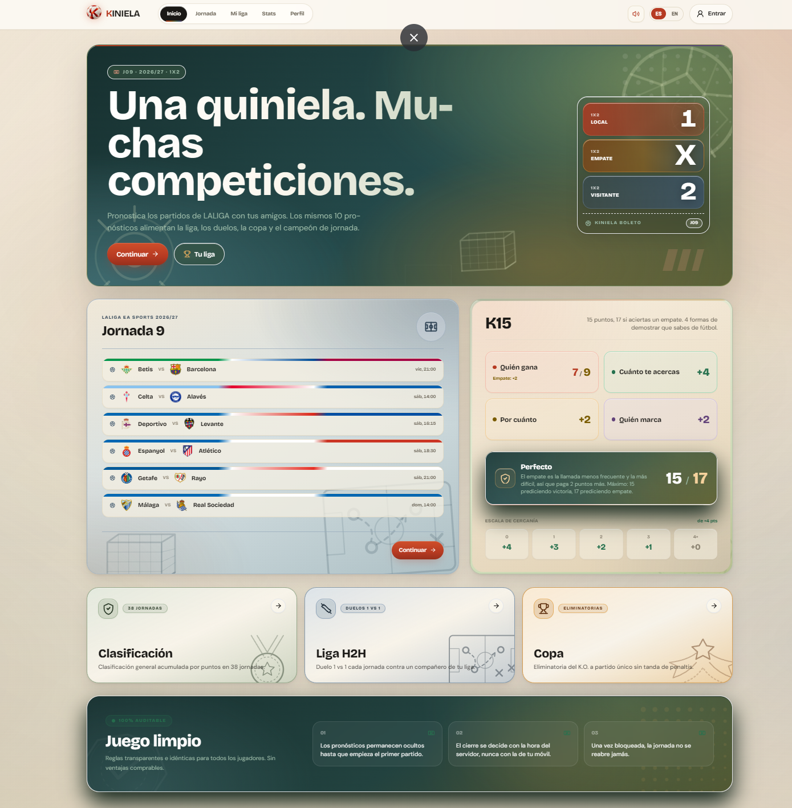
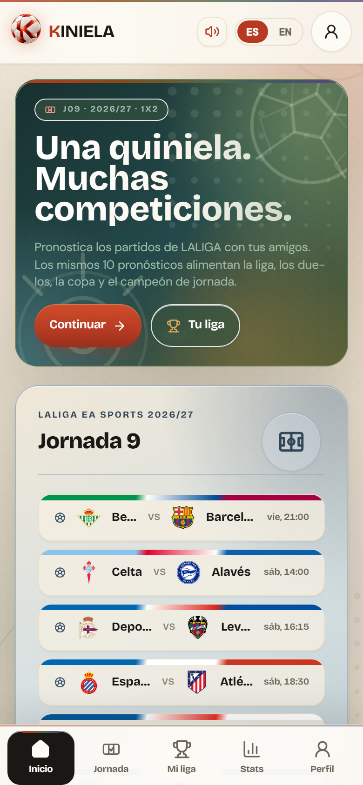
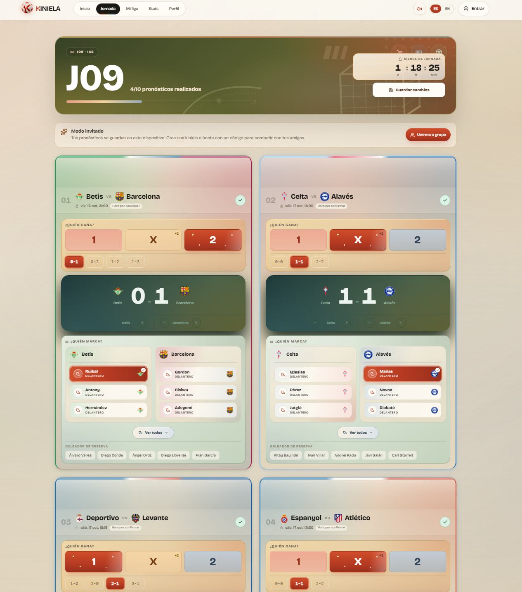
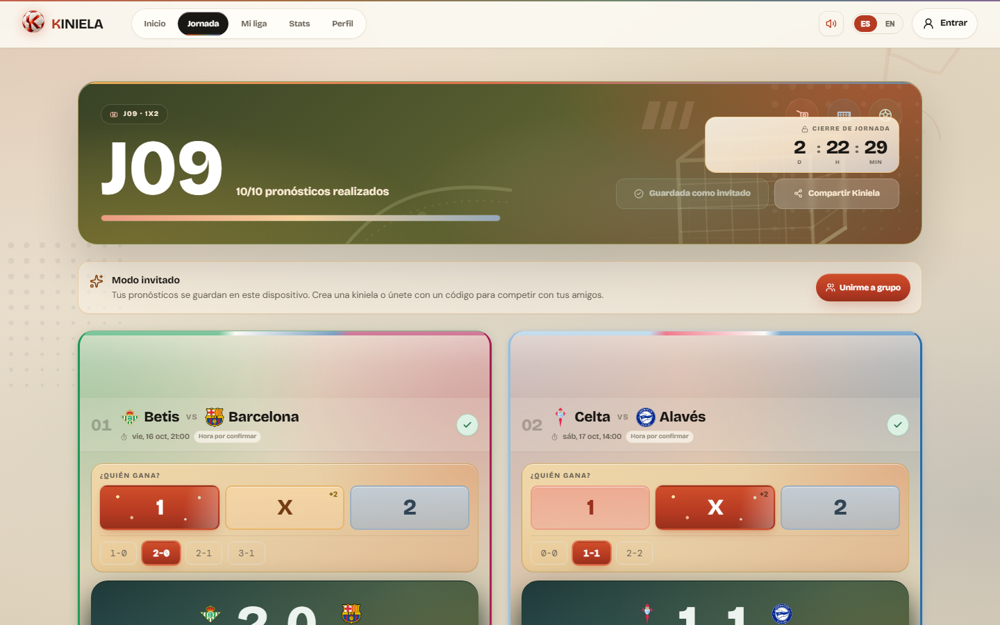

<div align="center">
  
  <h1>KINIELA</h1>
  <p><strong>Acierta. Afina. Pica a tus amigos.</strong></p>
  <p>Juego social de pronósticos de LALIGA: una quiniela, muchas competiciones.</p>
</div>

---

> **Galería pública.** Este repositorio reúne capturas y vídeos reales de KINIELA. No contiene el código de la aplicación, ni datos, ni configuración de servicios. Juega ahora: *URL canónica pendiente de confirmación por el propietario.*
>
> **Public gallery.** This repository holds real screenshots and videos of KINIELA. It contains no application source, data or service configuration.

## Qué es KINIELA

Cada jornada haces **10 pronósticos**: `1 / X / 2` más marcador y goleador. Esos mismos pronósticos alimentan la clasificación general, el campeón de jornada, una liga cara a cara (H2H), una copa eliminatoria y tus estadísticas. No hay que alinear a nadie ni fichar: basta con predecir y comparar.

## Galería

Todo el material está en [`media/`](media/), ordenado por pantalla.

### Inicio

| Escritorio | Móvil |
| --- | --- |
|  |  |

### Jornada

| Pronósticos introducidos | Guardada en escritorio | Guardada en móvil |
| --- | --- | --- |
|  |  |  |

### Vídeos

**Recorrido de la aplicación (≈ 1 min, sin audio).** Inicio, una jornada completa, goles en directo y la sección Mi liga.

<video controls preload="metadata" poster="media/videos/recorrido/kiniela-recorrido-poster.jpg" src="media/videos/recorrido/kiniela-recorrido.mp4" width="360"></video>

**Tráiler original.** Capturas aprobadas de la aplicación original.

<video controls preload="metadata" poster="media/videos/trailer-original/kiniela-trailer-original-poster.jpg" src="media/videos/trailer-original/kiniela-trailer-original.mp4" width="100%"></video>

## Estructura del repositorio

```text
media/
  brand/                 marca (favicon)
  images/
    inicio/              pantalla de inicio, escritorio y móvil
    jornada/             pronósticos y estado guardado
  videos/
    recorrido/           recorrido completo de la aplicación
    trailer-original/    tráiler aprobado de la aplicación original
docs/
  GALLERY.md             inventario de cada archivo y su origen
  PUBLIC_CONTENT_POLICY.md  qué puede y qué no puede publicarse
scripts/                 comprobaciones sin dependencias (contenido, enlaces, medios)
tests/                   pruebas del escáner de contenido
.github/                 CI: verificación, escaneo de secretos y CodeQL
```

## Qué no contiene

- Código fuente de la aplicación, ni componentes, ni rutas, ni base de datos.
- Credenciales, claves, variables de entorno o identificadores de infraestructura.
- Datos de usuarios ni resultados de competiciones fuera de las capturas aprobadas.

## Verificación

No hace falta instalar nada más que Node.js 24:

```bash
npm run check
```

Ejecuta el escáner de contenido prohibido, la comprobación de enlaces, la validación de la biblioteca de medios y las pruebas. El mismo conjunto corre en CI en cada cambio.

## Licencia y atribución

Repositorio público de muestra, no de código abierto. Copyright © 2026 Iker Pérez. Todos los derechos reservados. Consulta [LICENSE.md](LICENSE.md), [NOTICE.md](NOTICE.md) y [ATTRIBUTION.md](ATTRIBUTION.md).

## Seguridad

Si encuentras un problema de seguridad, no lo publiques en *Issues*. Usa la notificación privada de vulnerabilidades del repositorio; detalles en [SECURITY.md](SECURITY.md).

---

<div align="center">
  <p><strong>Juega ahora</strong> — URL canónica pendiente de confirmación.</p>
</div>
