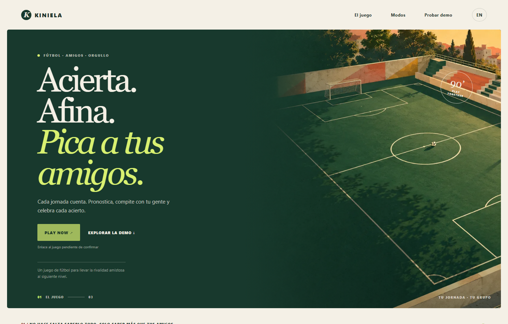
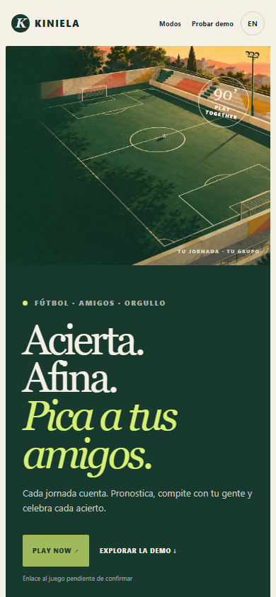
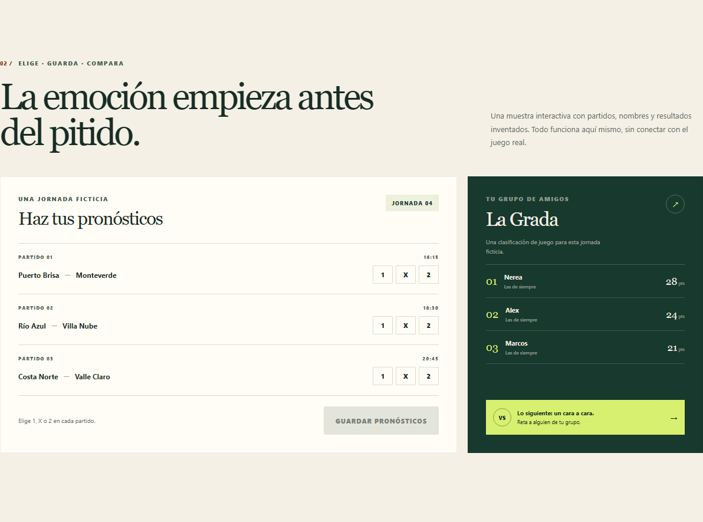
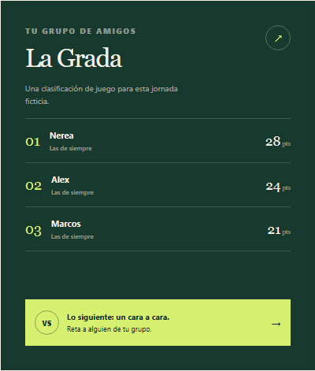
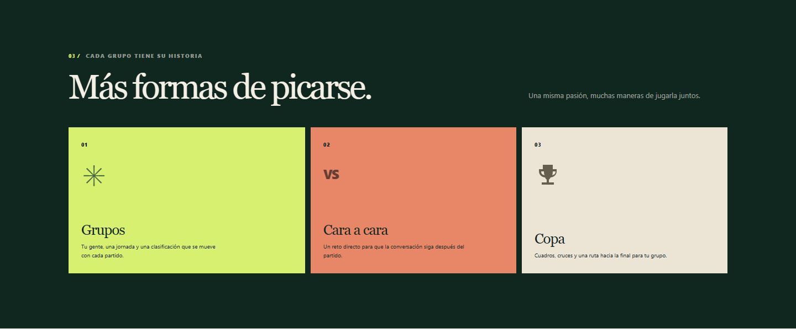
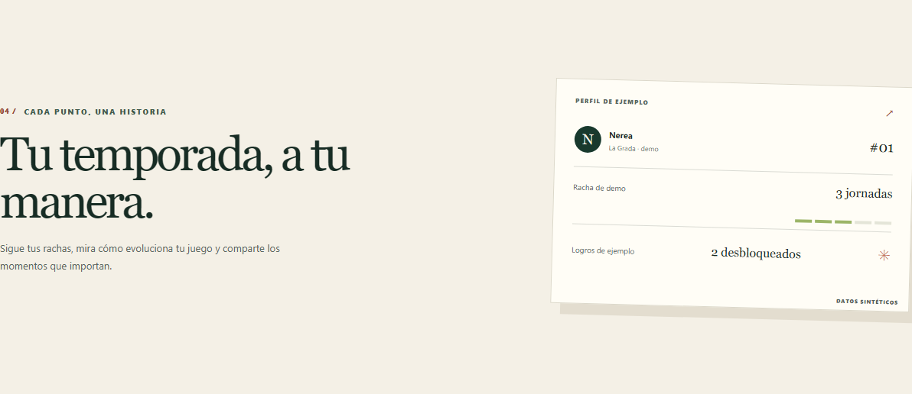
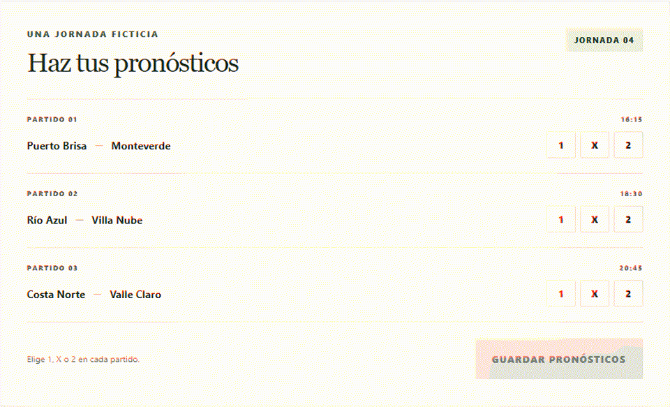

  
  <h1>KINIELA</h1>
  
<strong>Acierta. Afina. Pica a tus amigos.</strong>

  
<strong>PLAY NOW</strong> — pendiente de confirmar por el propietario la URL canónica del juego.

> **Public Showcase / Limited Reference Implementation**  
> This repository is a product gallery and a limited clean-room reference implementation created for demonstration. It does not contain the complete production application. The production scoring engine, backend, data model, security and abuse-prevention systems, integrations, operations, and a substantial portion of KINIELA remain private.
>
> **Galería pública / Implementación de referencia limitada.** Este repositorio muestra el producto e incluye una demo de referencia limitada creada desde cero. No contiene la aplicación de producción completa. El motor de puntuación, backend, modelo de datos, seguridad, prevención de abusos, integraciones, operaciones y una parte sustancial de KINIELA permanecen privados.

## The game

KINIELA is a social football prediction game built around matchday competition, groups, rankings and head-to-head challenges. Make predictions, compare them with friends, and follow a season together.

KINIELA es un juego social de pronósticos de fútbol. Cada jornada se convierte en una excusa para competir con amigos, seguir una clasificación y lanzar retos cara a cara.

## Screenshots

The gallery uses invented fixtures and sample profiles. No production account, match feed or private service is connected. See the [gallery notes](docs/GALLERY.md) for the image list and demo flow.

## Matchday experience

Choose a 1, X or 2 outcome for three fictional fixtures, save locally in the page state, and review a precalculated demo outcome. Its display points and explanation are illustrative only; they do not describe or calculate production scoring.

## Groups, H2H & Cup

The product experience includes social groups, head-to-head challenges and cup competition. This showcase describes those player-facing modes without publishing their production rules or implementation.

## Stats & progress

The page includes sample standings, fictional profile details, a streak preview and sample achievements. Every name and value shown in the demo is synthetic.

## Engineering showcase

The reference app uses strict TypeScript, small React components, accessible HTML controls, local fixtures, a reducer for demo UI state, unit tests, Playwright, accessibility checks and a CI pipeline. Its architecture is documented at [docs/ENGINEERING_OVERVIEW.md](docs/ENGINEERING_OVERVIEW.md).

## Demo architecture

<pre><code>Player
  ↓
Showcase UI
  ↓
Demo UI state
  ↓
Demo service interface
  ↓
Local fixture adapter → synthetic fixtures and precomputed outcome</code></pre>

Competitive state in the production game is decided by protected services. This public demo uses local synthetic fixtures and does not connect to production.

## Run the showcase

Requirements: Node.js 24 and npm.

<pre><code>npm ci
npm run dev</code></pre>

The demo needs no environment file, account, API, database or external service. To run checks:

<pre><code>npm run lint
npm run typecheck
npm test
npm run build
npx playwright install chromium
npm run test:e2e
npm run check:forbidden
npm run check:links
npm audit</code></pre>

## What is included

- A responsive product gallery with fictional profiles and fixtures.
- A limited, local-only prediction flow with a precomputed example outcome.
- Reusable presentation components, accessible controls and Spanish/English interface copy.
- Unit tests, browser tests, offline network checks, secret scanning and static analysis workflows.

## What is intentionally private

- Production scoring engine, formulas, rules and private test vectors.
- Production backend, database schema, policies and security systems.
- Match ingestion, data providers, operational tooling and infrastructure.
- Admin and scheduled operations, anti-abuse mechanisms and deployment details.
- A substantial portion of the production features and application.

## Security

Please do not report vulnerabilities in public Issues or Discussions. Use the repository's private vulnerability reporting feature when available; see [SECURITY.md](SECURITY.md).

## Contributing

Contributions are limited to gallery UI, accessibility, translations, documentation and bugs in this isolated demo. Read [CONTRIBUTING.md](CONTRIBUTING.md) first.

## License

This is a **public-source showcase, not an open-source release**. Copyright © 2026 Iker Pérez. All rights reserved. See [LICENSE.md](LICENSE.md) and [NOTICE.md](NOTICE.md).

## Credits

The hero artwork was created specifically for this showcase. No real teams, players, match calendars, official badges or production data are included. See [ATTRIBUTION.md](ATTRIBUTION.md).

  
<strong>PLAY NOW</strong> — the canonical game URL will be added after owner confirmation.

